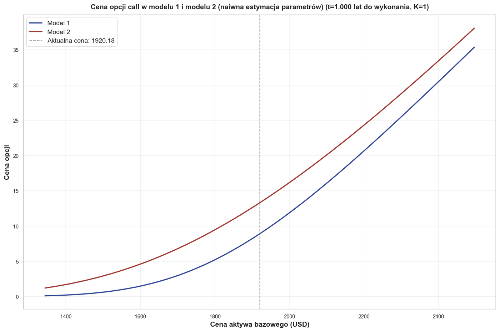
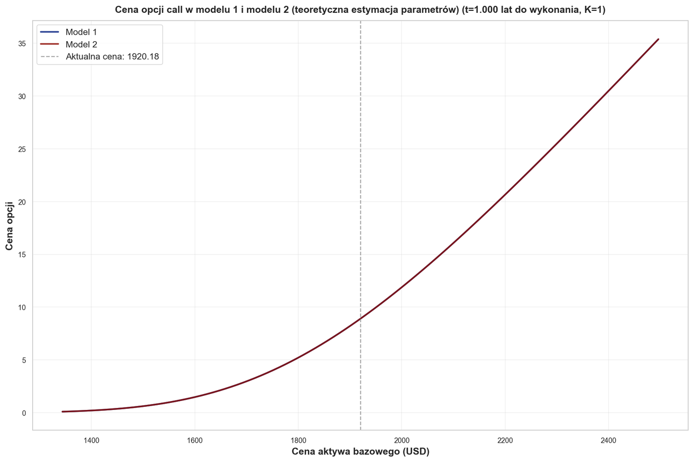
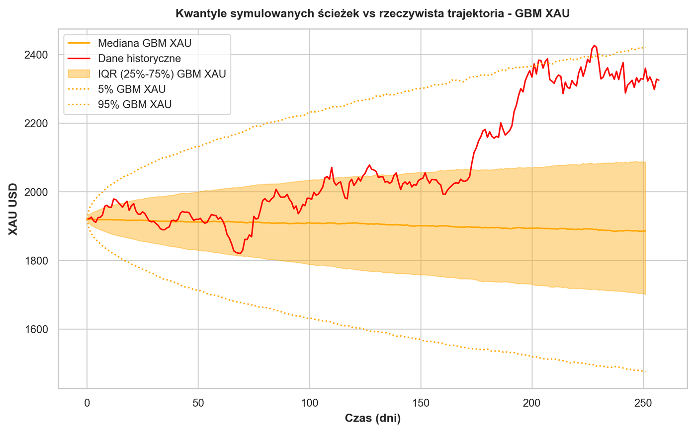
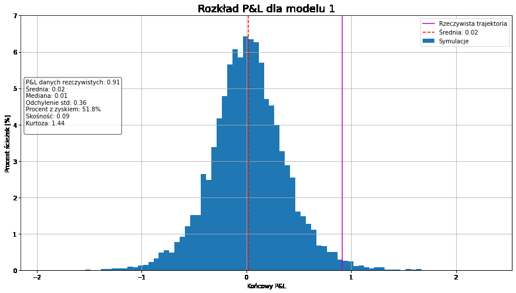

# Quanto Option on Gold with PLN Payout

**Pricing and hedging a cross-currency (quanto) call on gold (XAU/USD) that pays out in Polish złoty, under correlated geometric Brownian motions, with a proof that two modelling approaches agree and a demonstration of why a naive calibration breaks that agreement.**


## The problem

The valuation date is 30 June 2023 and the instrument pays at T = 30 June 2024:

```
payoff = 100 PLN × max( S(T) / S(0) − K , 0 ),     0 ≤ K ≤ 2
```

S(t) is the gold price in USD. The holder takes gold-price risk but receives a fixed number of złoty, so the USD/PLN rate X(t) enters the price only through its **correlation** with gold.

Two model formulations are compared:

1. **Model 1, (X, S)**: USD/PLN and gold in USD as correlated GBMs
2. **Model 2, (X, Y)**: USD/PLN and gold in PLN, Y(t) = X(t)·S(t)

## Key results

- **Closed-form prices in both models.** The PDE is derived from a replicating portfolio (Itô's formula with cross-variation) and reduced to Black–Scholes form with an effective volatility and dividend yield. In model 1 the quanto adjustment enters as q = r − r_f + ρσ_X σ_S.
- **The models are equivalent if Y is parametrised consistently.** If Y is treated as the product of two correlated GBMs, its parameters follow analytically: σ̃² = σ_X² + σ_S² + 2ρσ_Xσ_S and ρ′ = (σ_X + ρσ_S)/σ̃. Substituting them reduces the model 2 formula exactly to model 1, and numerically the prices agree to the 3rd–4th decimal place.
- **A naive calibration silently breaks this.** Estimating Y's parameters directly from the product of historical series inflates σ_Y (0.194 vs. a consistent 0.157) and flips the sign of the correlation (−0.22 vs. +0.42). The option price rises from **8.90 to 13.46** and the hedge P&L spread roughly doubles.
- **Calibration** uses three years of daily data (σ_gold ≈ 15.0%, σ_USD/PLN ≈ 11.6%, ρ ≈ −0.34, r = 5.5%, r_f = 3.5%). The window was chosen after comparing rolling volatilities and correlations over 1–4 year windows.
- **Delta hedging** works on simulated paths: P&L is centred at zero, and the realised 2023–24 path lands in the tail because gold broke above the model's 95% quantile. The study also covers sensitivity to rehedging frequency, strike, assumed correlation and both volatilities.
- **Price sensitivity heatmaps** over (σ_gold, time), (σ_gold, K), (σ_gold, ρ) and (r, r_f). Two extensions follow: pricing a plain option to buy gold at S(0)·X(0) from a Polish and from a US investor's point of view.

<p align="center">
  
  
</p>
<p align="center"><em>Option price in model 1 vs. model 2. Left: naive estimation of Y's parameters. Right: parameters derived from the SDE, where the curves coincide.</em></p>

<p align="center">
  
  
</p>
<p align="center"><em>Left: simulated XAU/USD quantiles vs. the realised path. Right: delta-hedge P&L in model 1, with the historical path marked.</em></p>

## What's implemented

- **Calibration** from daily XAU/USD and USD/PLN data (2010 to June 2023): rolling volatilities, mean returns and correlations
- **Pricing and deltas** with the quanto drift correction for both formulations
- **Correlated GBM simulation** via Cholesky decomposition (with a regularisation fallback) and empirical validation of the simulated correlation
- **Delta-hedging engine** for both models: P&L distributions, portfolio composition over time, backtest on the realised path
- **Sensitivity analysis**: P&L tests and price heatmaps, run side by side for both models
- Interactive **Plotly** visualisations and animations

## Repository structure

```
src/quanto_options/   data_loader, pricing, simulation (correlated GBM),
                      hedging, visualization, dual_model_visualization
scripts/              run_analysis (calibration → pricing → hedging), examples, animation
data/raw/             xauusd_d.csv, usdpln_d.csv (daily prices)
reports/              full report and project brief (PDF, in Polish)
```

## How to run

```bash
python -m pip install -e .
python -m scripts.run_analysis
```

Smoke tests: `python -m unittest discover -s tests`.

## Report

📄 [Full report (PDF, Polish, 39 pages)](reports/Quanto_report_Karawan_Kozlowski_Trykowski.pdf). 📝 [Project brief (PDF, Polish)](reports/Projekt%203%20%20-%20IF1%202025.pdf)

**Authors:** Maciej Karawan, Jakub Kozłowski, Wiktor Trykowski. Financial Engineering I course project, 2025.
